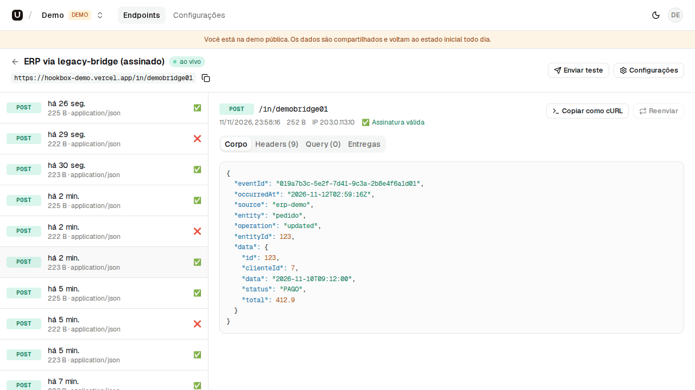
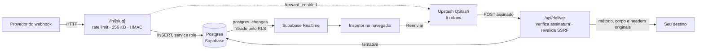

# Hookbox

Caixa de entrada multi-tenant para webhooks: receba numa URL própria, inspecione cada requisição em tempo real, confira a assinatura HMAC e encaminhe para a sua aplicação com retry.

[](https://github.com/BernardoCusmanich/hookbox/actions/workflows/ci.yml)

**Demo ao vivo:** https://hookbox-demo.vercel.app (botão “Entrar na demo”, sem cadastro)



## Funcionalidades

- **URL de ingestão por endpoint** (`/in/<slug>`) que aceita GET, POST, PUT, PATCH, DELETE, HEAD e OPTIONS, com corpo de até 256 KB.
- **Inspetor em tempo real** via Supabase Realtime: método, horário, tamanho e selo da assinatura de cada requisição; corpo com JSON formatado, headers, query e histórico de entregas.
- **Verificação de assinatura HMAC-SHA256** compatível com o [legacy-bridge](https://github.com/BernardoCusmanich/legacy-bridge), com janela de ±5 minutos para o timestamp. O status é informativo: a requisição é gravada mesmo com assinatura inválida.
- **Encaminhamento com retry** pelo Upstash QStash (até 5 novas tentativas), com proteção contra SSRF e botão “Reenviar”.
- **Transformação de payload** opcional por endpoint: um template JSON com `{{ body.campo }}`, `{{ headers.nome }}`, `{{ query.param }}` e `{{ method }}` gera o corpo encaminhado, com pré-visualização nas configurações.
- **Alerta por e-mail** (SMTP; em produção, um Gmail do projeto) para os owners da organização quando uma entrega falha de vez: erro permanente, URL recusada ou as 5 novas tentativas esgotadas. No máximo um e-mail por endpoint por hora.
- **API pública REST** (`/api/v1`) com chaves de API por organização, para listar endpoints e requisições, ver uma requisição e reenviá-la.
- **“Copiar como cURL”** e **“Enviar teste”** direto do inspetor.
- **Multi-tenant**: organizações, papéis (owner e membro), convites por link e seletor de organização, com o isolamento feito por RLS no Postgres.
- **Segredos cifrados** com AES-256-GCM; `authorization`, `cookie`, `proxy-authorization` e `x-api-key` são gravados como `[redacted]`.
- **Rate limit** de 60 req/min por endpoint e 120 req/min por IP (Upstash Redis).
- **Limpeza diária** (Vercel Cron): apaga requisições com mais de 7 dias e restaura a organização demo.
- Login por magic link ou GitHub, modo claro e escuro, layout responsivo e interface em português.

## Fluxo



## Usando com o legacy-bridge

O [legacy-bridge](https://github.com/BernardoCusmanich/legacy-bridge) é um agente .NET que lê mudanças de um banco Firebird legado e envia eventos assinados (`entity`, `operation`, `data`) para um webhook. O Hookbox valida exatamente o mesmo formato de assinatura:

```
x-bridge-signature = "sha256=" + hex(HMAC-SHA256(segredo, "{x-bridge-timestamp}.{corpo bruto}"))
```

1. No Hookbox, crie um endpoint e, em **Configurações → Segredo de assinatura**, clique em **Gerar segredo**. Use **Revelar** para copiá-lo.
2. Aponte o agente para a URL de ingestão do endpoint:

   ```powershell
   [Environment]::SetEnvironmentVariable("Bridge__Webhook__Url", "https://hookbox-demo.vercel.app/in/<slug>", "Machine")
   [Environment]::SetEnvironmentVariable("Bridge__Webhook__Secret", "<segredo do Hookbox>", "Machine")
   ```

   Ou, no desenvolvimento, com user-secrets:

   ```bash
   dotnet user-secrets set "Bridge:Webhook:Url" "https://hookbox-demo.vercel.app/in/<slug>"
   dotnet user-secrets set "Bridge:Webhook:Secret" "<segredo do Hookbox>"
   ```

3. Gere uma mudança no ERP (ou rode o simulador do legacy-bridge). Cada evento aparece no inspetor com ✅ quando a assinatura e o timestamp conferem, ❌ quando não conferem e — quando os headers não vieram.
4. Opcional: ligue o **encaminhamento** para repassar os eventos ao seu backend. Os headers `x-bridge-*` vão junto, então o destino pode validar a assinatura de novo.

O Hookbox responde `200` em toda requisição gravada, então o bridge marca o evento como `sent`. Na demo, o endpoint “ERP via legacy-bridge (assinado)” já tem exemplos com assinatura válida, inválida, ausente e com timestamp vencido.

## API pública

A API REST v1 permite listar endpoints e requisições, ver uma requisição com o histórico de entregas e reenviá-la, sem abrir o painel.

**Chave de API.** Em **Configurações → Chaves de API** (só owners), dê um nome e clique em **Criar chave**. A chave (`hbk_...`) aparece uma única vez; o Hookbox guarda só o prefixo e o hash SHA-256. Cada organização pode ter até 5 chaves, e excluir uma chave a revoga na hora. A criação não está disponível na demo pública.

**Autenticação.** Envie a chave no header `Authorization: Bearer <chave>`. A chave dá acesso apenas aos dados da organização dela.

**Limite.** 60 requisições por minuto por chave. Acima disso, a resposta é `429` com o header `Retry-After` (em segundos).

**Formato das respostas.** Sucesso: `{ "data": ... }`. Erro: `{ "error": { "code": "...", "message": "..." } }`, com a mensagem em português.

| Status | `code` | Quando |
| --- | --- | --- |
| 400 | `invalid_parameter` | `limit` ou `before` inválido |
| 401 | `unauthorized` | chave ausente, malformada ou revogada |
| 404 | `not_found` | o recurso não existe ou é de outra organização |
| 409 | `forwarding_disabled` | reenvio de um endpoint sem encaminhamento ativo |
| 429 | `rate_limited` | mais de 60 requisições por minuto |
| 502 | `queue_error` | falha ao enfileirar o reenvio |

Nos exemplos abaixo, `HOOKBOX_URL` é a URL do app (por exemplo, `https://hookbox-demo.vercel.app`) e `HOOKBOX_KEY` é a chave.

### `GET /api/v1/endpoints`

```bash
curl -H "Authorization: Bearer $HOOKBOX_KEY" "$HOOKBOX_URL/api/v1/endpoints"
```

```json
{
  "data": [
    {
      "id": "0b6f3c1e-1f2a-4d3b-9c4d-5e6f7a8b9c0d",
      "name": "Pagamentos",
      "slug": "abcdefghijkl",
      "ingest_url": "https://hookbox-demo.vercel.app/in/abcdefghijkl",
      "forward_enabled": true,
      "forward_url": "https://api.suaempresa.com/webhooks",
      "transform_enabled": false,
      "created_at": "2026-11-12T10:00:00+00:00"
    }
  ]
}
```

### `GET /api/v1/endpoints/{id}/requests`

Lista as requisições do endpoint, da mais recente para a mais antiga. Parâmetros opcionais: `limit` (inteiro de 1 a 100, padrão 20) e `before` (timestamp ISO 8601; só traz requisições recebidas antes dele). Para a próxima página, passe o `next_cursor` como `before`. Quando não há mais páginas, `next_cursor` é `null`.

```bash
curl -H "Authorization: Bearer $HOOKBOX_KEY" \
  "$HOOKBOX_URL/api/v1/endpoints/<id>/requests?limit=2"
```

```json
{
  "data": [
    {
      "id": "2f1d6a52-9d2e-4c52-8a55-1d3b6f0e9a11",
      "method": "POST",
      "path": "/in/abcdefghijkl",
      "query": { "loja": "sp" },
      "content_type": "application/json",
      "size_bytes": 73,
      "signature_status": "valid",
      "received_at": "2026-11-12T17:42:32.465086+00:00"
    }
  ],
  "next_cursor": null
}
```

```bash
# próxima página
curl -H "Authorization: Bearer $HOOKBOX_KEY" \
  "$HOOKBOX_URL/api/v1/endpoints/<id>/requests?limit=2&before=2026-11-12T17:42:32.465086Z"
```

### `GET /api/v1/requests/{id}`

```bash
curl -H "Authorization: Bearer $HOOKBOX_KEY" "$HOOKBOX_URL/api/v1/requests/<id>"
```

```json
{
  "data": {
    "id": "2f1d6a52-9d2e-4c52-8a55-1d3b6f0e9a11",
    "endpoint_id": "0b6f3c1e-1f2a-4d3b-9c4d-5e6f7a8b9c0d",
    "method": "POST",
    "path": "/in/abcdefghijkl",
    "query": {},
    "headers": { "content-type": "application/json" },
    "body": "{\"id\":42}",
    "body_encoding": "utf8",
    "content_type": "application/json",
    "size_bytes": 9,
    "ip": "203.0.113.7",
    "signature_status": "valid",
    "received_at": "2026-11-12T17:42:32.465086+00:00",
    "deliveries": [
      { "attempt": 1, "status_code": 200, "error": null, "duration_ms": 120, "created_at": "2026-11-12T17:42:33+00:00" }
    ]
  }
}
```

### `POST /api/v1/requests/{id}/resend`

Enfileira um novo envio da requisição para o destino do endpoint. O resultado aparece nas `deliveries` da requisição.

```bash
curl -X POST -H "Authorization: Bearer $HOOKBOX_KEY" "$HOOKBOX_URL/api/v1/requests/<id>/resend"
```

```json
{ "data": { "queued": true } }
```

Responde `202` quando enfileirou e `409` (`forwarding_disabled`) se o endpoint não tem encaminhamento ativo com uma URL.

## Rodando localmente

Pré-requisitos: Node.js 24, Docker (para o Supabase local).

```bash
npm install

# 1. Supabase local: Postgres, Auth, Realtime e Mailpit (e-mails em http://127.0.0.1:54324)
npx supabase start            # aplica as migrations de supabase/migrations
npx supabase status           # mostra a URL, a anon key e a service role key

# 2. Variáveis de ambiente
cp .env.example .env.local    # preencha com os valores do passo 1 e os segredos abaixo
openssl rand -base64 32       # ENCRYPTION_KEY
openssl rand -hex 32          # CRON_SECRET

# 3. QStash local (outro terminal): mostra QSTASH_TOKEN e as signing keys; use QSTASH_URL=http://127.0.0.1:8080
npm run qstash:dev

# 4. Usuário, organização e requisições da demo
npm run seed

# 5. App
npm run dev                   # http://localhost:3000
```

**Rate limit no desenvolvimento.** O `@upstash/ratelimit` usa um recurso de script Lua que só existe no Upstash, então ele não roda contra um Redis comum. Crie um banco Redis gratuito em [console.upstash.com](https://console.upstash.com) e use a URL e o token REST dele. Sem isso, a ingestão funciona normalmente, mas o rate limit fica desligado (fail-open) e um aviso aparece no log.

**Redis local.** `docker compose -f docker-compose.dev.yml up -d` sobe um Redis com a API REST do Upstash em `http://127.0.0.1:8079` (use o mesmo token em `UPSTASH_REDIS_REST_TOKEN` e no compose). Ele atende a trava dos alertas, mas não o rate limit, pelo motivo acima.

**Alertas no desenvolvimento.** Sem `SMTP_HOST`, os alertas de falha não são enviados (o log mostra `alerta de falha: disabled`). Para vê-los localmente, aponte o SMTP para um Mailpit (`SMTP_HOST=127.0.0.1`, `SMTP_PORT=1025`).

**Encaminhamento no desenvolvimento.** A proteção contra SSRF recusa `localhost` e IPs privados também localmente. Para testar uma entrega de verdade, use uma URL pública (por exemplo, um endpoint temporário do webhook.site).

**Login com GitHub local.** Crie um OAuth App com o redirect URI `http://127.0.0.1:54321/auth/v1/callback` e grave as credenciais em `supabase/.env` (fora do git), que o Supabase CLI lê sozinho:

```bash
SUPABASE_AUTH_EXTERNAL_GITHUB_CLIENT_ID=...
SUPABASE_AUTH_EXTERNAL_GITHUB_SECRET=...
```

Depois rode `npx supabase stop && npx supabase start`. Sem esse arquivo, o Supabase local sobe normalmente, e só o botão do GitHub falha. O mesmo OAuth App pode servir às previews: basta acrescentar o callback do Supabase de preview como segundo redirect URI.

### Testes

```bash
npm test          # unitários e integração (assinatura, crypto, SSRF, ingestão, encaminhamento)
npm run db:test   # pgTAP: RLS, triggers e RPCs (precisa do Supabase local)
npm run lint
npm run typecheck
```

Outros comandos: `npm run db:types` regenera `lib/supabase/types.ts` a partir do banco local.

## Deploy na Vercel

1. **Supabase:** crie um projeto e aplique as migrations:
   ```bash
   npx supabase link --project-ref <ref>
   npx supabase db push
   ```
   Em **Authentication → URL Configuration**, defina o *Site URL* como `https://<seu-app>.vercel.app` e adicione `https://<seu-app>.vercel.app/auth/callback` às *Redirect URLs*. Em **Providers**, mantenha o e-mail com confirmação ligada e configure o GitHub, com o callback que o Supabase mostra.
   Os e-mails de autenticação em português ficam em `supabase/templates` (o Supabase local já os usa). Para aplicá-los no projeto hospedado, rode `npm run email:templates -- <ref>` depois do `supabase login`.
2. **Upstash:** crie um banco Redis e pegue o token e as signing keys do QStash no console.
3. **Vercel:** importe o repositório e cadastre todas as variáveis do `.env.example` (sem `QSTASH_URL`). `APP_URL` precisa ser a URL pública final, porque é ela que o QStash chama e que o `/api/deliver` usa para conferir a assinatura. `SMTP_HOST`, `SMTP_USER` e `SMTP_PASSWORD` (opcionais) ligam os alertas de falha. Com Gmail, use `smtp.gmail.com` e uma senha de app; o mesmo SMTP pode servir aos e-mails de login do Supabase (Authentication → SMTP Settings).
4. Faça o deploy. O build falha se faltar alguma variável.
5. Rode o seed apontando para produção, uma vez: `npm run seed` com as variáveis de produção num `.env.production.local`. Atenção: enquanto esse arquivo existir, ele tem prioridade sobre o `.env.local`, e o seed vai sempre para produção.
6. O cron (`vercel.json`) roda todo dia às 03:00 UTC e chama `/api/cron/cleanup` com `Authorization: Bearer $CRON_SECRET`. A Vercel envia esse header sozinha quando a variável `CRON_SECRET` existe.

### Previews

As previews (branches e PRs) usam um **Supabase separado**, para nunca tocar no banco de produção:

1. Crie um segundo projeto Supabase, aplique as migrations e rode o seed com as variáveis dele exportadas no shell. Elas têm prioridade sobre o `.env.production.local`.
2. Em *Redirect URLs*, adicione `https://<projeto>-*-<time>.vercel.app/auth/callback`, que cobre as URLs de branch e de deploy.
3. Na Vercel, cadastre no ambiente **Preview** as variáveis do Supabase de preview, além de `ENCRYPTION_KEY`, `CRON_SECRET`, `DEMO_EMAIL` e `DEMO_PASSWORD` próprias. **Não** defina `APP_URL`: nas previews ela vem de `VERCEL_BRANCH_URL`. QStash e Redis podem ser compartilhados.
4. Em **Settings → Deployment Protection**, ligue o *Protection Bypass for Automation*. A Vercel passa a expor `VERCEL_AUTOMATION_BYPASS_SECRET`, e o app manda esse valor no header `x-vercel-protection-bypass` das mensagens do QStash, para o `/api/deliver` passar pela proteção.

Para mandar um webhook externo para uma preview, acrescente `?x-vercel-protection-bypass=<segredo>` à URL de ingestão. Parâmetros `x-vercel-*` são descartados antes de gravar, então o segredo não aparece no inspetor.

## Decisões técnicas

**RLS como fronteira de multi-tenancy.** O isolamento entre organizações não depende de cada query lembrar de um `where org_id = ...`: ele está nas policies do Postgres, com `is_member(org)` e `is_owner(org)` (`security definer`, `stable`). O app usa a chave anon com a sessão do usuário em todo acesso a dados, e a service role só aparece em cinco lugares: a ingestão, o `/api/deliver`, o cron, a API pública (`/api/v1`, onde toda consulta filtra pelo `org_id` da chave de API) e o seed. Um bug numa Server Action resulta em “nenhuma linha”, não em vazamento. As actions ainda conferem a membership explicitamente, para dar mensagens de erro claras e como segunda camada. O Realtime herda as mesmas policies, então um usuário não consegue assinar as requisições de outra organização. As regras que o RLS não expressa bem viram triggers: o limite de 5 endpoints e o “sempre pelo menos um owner”. Tudo isso é coberto pelos testes pgTAP em `supabase/tests`.

**QStash em vez de worker próprio.** Na Vercel não existe processo de longa duração para consumir uma fila. O QStash guarda a mensagem, chama o `/api/deliver` e refaz a chamada com backoff quando a resposta é 5xx. A rota fica sem estado: verifica a assinatura do QStash, faz uma tentativa, grava o resultado em `deliveries` e devolve `500` para pedir retry (5xx, 408, 429, timeout, erro de rede) ou `200` para encerrar (2xx, 4xx, redirect). O número da tentativa vem do header `Upstash-Retried`. O custo é uma dependência externa; o ganho é não operar fila, worker nem cron de reprocessamento.

**Por que redigir headers sensíveis.** Um inspetor de webhooks guarda dados de terceiros e mostra esses dados para todos os membros da organização. `authorization`, `cookie`, `proxy-authorization` e `x-api-key` costumam carregar credenciais de longa duração, que não ajudam a depurar e virariam um risco se fossem gravadas. Por isso viram `[redacted]` antes do INSERT e não são reenviadas no encaminhamento. Os headers `x-vercel-*` são descartados pelo mesmo motivo: a plataforma os injeta (inclusive um token OIDC do projeto) e eles não vieram do provedor. A assinatura HMAC continua funcionando, porque usa headers próprios (`x-bridge-*`).

**Proteção contra SSRF.** Encaminhar para uma URL escolhida pelo usuário é um convite para alcançar a rede interna, como o metadata da cloud em `169.254.169.254`. A URL é validada ao salvar e de novo antes de cada envio: só `https`, sem usuário e senha na URL, sem o próprio domínio do Hookbox, e nenhum dos IPs resolvidos (`dns.lookup` com `all: true`) pode ser loopback, privado, link-local, CGNAT, multicast, reservado ou IPv4 embutido em IPv6. Validar só antes do fetch abre espaço para DNS rebinding (o domínio resolve para um IP público na checagem e para um interno na conexão). Por isso o envio usa um `undici.Agent` com um `lookup` próprio, que confere o IP no momento em que o socket conecta, e IP literal é checado à parte. Redirects não são seguidos (`redirect: 'manual'`) e contam como falha permanente, e cada tentativa tem timeout de 10 s. Para evitar loops (um endpoint encaminhando para outro, inclusive por uma URL alternativa do mesmo deploy), uma requisição que chega com `x-hookbox-request-id` é gravada, mas não é reencaminhada.

**Transformação de payload.** Cada endpoint pode ter um template JSON (até 10.000 caracteres). Só os valores string são processados: `"{{ body.order.id }}"` sozinho mantém o tipo original (número, objeto, array, `null` se ausente) e, dentro de um texto maior, vira string. Os caminhos começam em `body`, `headers` (minúsculas), `query` ou `method` e aceitam `.chave` e `[índice]`. Por exemplo, para transformar um evento num payload de Slack:

```json
{"text": "Pedido {{ body.id }}: {{ body.status }}"}
```

O template é percorrido como dados (sem `eval`), com limite de profundidade e de 256 KB na saída. O `/api/deliver` envia o resultado como `application/json`; se o template falhar, a entrega é gravada com o erro e os owners recebem o alerta. Sem template, o corpo original é encaminhado como antes. Na demo o campo fica desabilitado, mas a pré-visualização funciona.

**Outras escolhas.**
- `proxy.ts` (o antigo `middleware.ts` do Next.js 16) renova a sessão, protege `/app/**` e manda para o onboarding quem ainda não tem organização.
- A conta demo é compartilhada, então tem papel de *membro* (não mexe em membros, convites nem no nome da org), não cria organizações e não consegue trocar a própria senha ou o e-mail (um trigger em `auth.users` descarta a mudança). As travas também estão no banco (triggers da migration `demo_guards`), e só agem quando quem chama é a conta demo, então o seed e o cron passam. Na demo não dá para mudar o encaminhamento nem gerar ou remover o segredo. Revelar o segredo continua liberado, para testar a assinatura. Os endpoints de exemplo e a org não podem ser excluídos, e o cron restaura tudo por dia. O `/api/deliver` não envia nada para orgs demo: registra a entrega como "Encaminhamento desativado na demo.".
- O Supabase Auth não separa um cadastro por senha de um por magic link. O cadastro por senha não aparece na interface, a confirmação de e-mail fica obrigatória e o aceite de convite exige e-mail confirmado. Assim, uma conta criada direto pela API com o e-mail de outra pessoa não consegue tomar um convite.
- Corpos que não são UTF-8 válido (ou que contêm `\0`, que o Postgres não aceita em `text`) são gravados em base64 e reenviados com os bytes originais.
